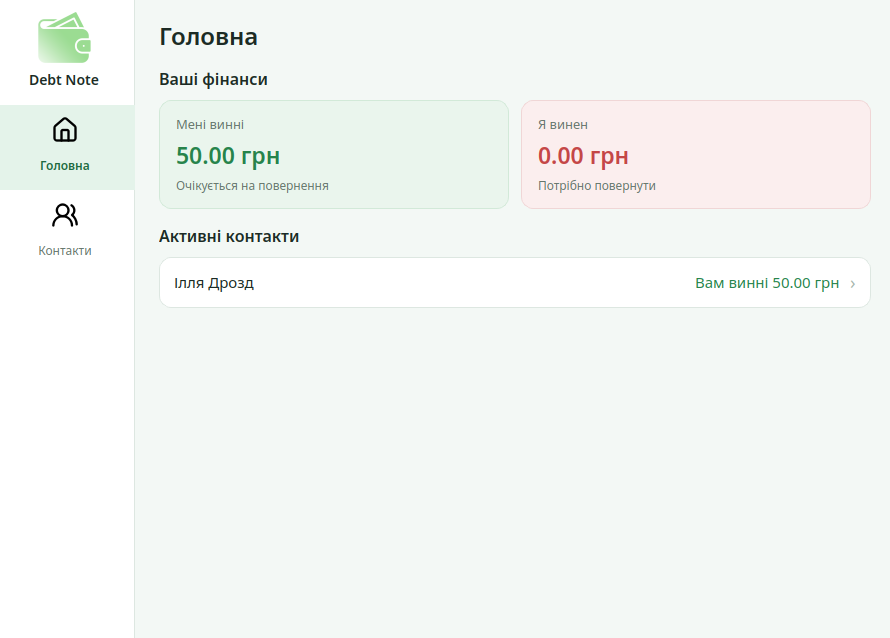
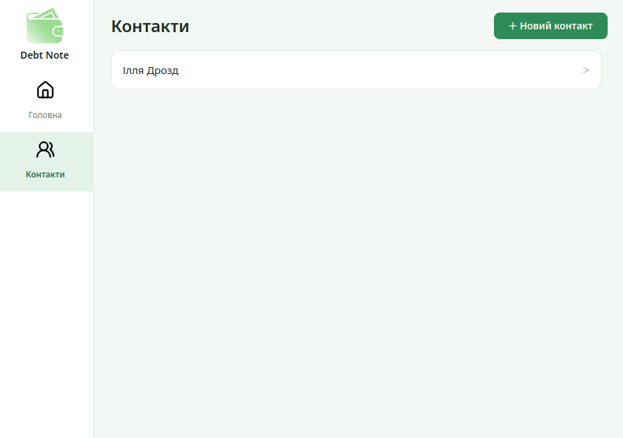
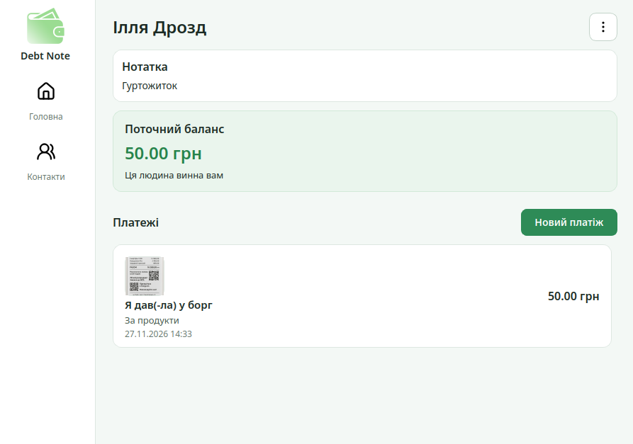
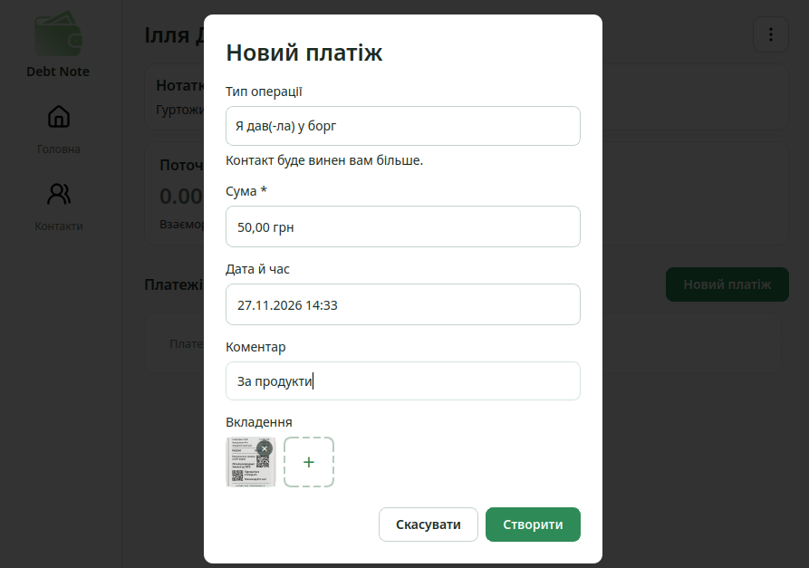

# DebtNote

Десктопний застосунок на Qt для обліку особистих боргів: кому винні ви і хто винен вам. Усі дані зберігаються локально.

## Можливості

- Контакти: створення, редагування та видалення людей, з якими виникають борги (ім'я, прізвище, нотатка).

- Платежі чотирьох типів: "Я дав у борг", "Я взяв у борг", "Мені повернули борг", "Я повернув борг". Кожен платіж має суму, дату й час та коментар.

- Баланс розраховується автоматично з платежів, без ручних підрахунків. Додатне значення означає, що контакт винен вам, від'ємне, що ви винні контакту.

- До платежу можна прикріпити до 5 файлів (фото чека, скріншот переписки) з попереднім переглядом.

- При видаленні платежу чи контакту видаляються пов'язані платежі, записи вкладень і їхні копії файлів. Оригінальні файли користувача не змінюються.

- В якості локального сховища використовується SQLite, один файл бази даних.

## Скріншоти

### Головна



### Контакти



### Вибраний контак



### Стоврення нового платежу



## Готова збірка

Портативні збірки (які запускаються без встановлення) лежать на сторінці [Releases](https://github.com/bihdanysche/DebtNote/releases):

## Збірка з вихідного коду

### Вимоги

- CMake 3.16 або новіший
- Компілятор із підтримкою C++17 (MSVC 2019+ на Windows, GCC або Clang на Linux)
- Qt 6 (розробка велась на 6.8) з модулями Core, Widgets, Sql, Svg. Драйвер SQLite QSQLITE входить до стандартної збірки Qt.

### Команди

```bash
git clone https://github.com/bihdanysche/DebtNote.git
cd DebtNote

cmake -S . -B build -DCMAKE_BUILD_TYPE=Release -DCMAKE_PREFIX_PATH=<шлях _до_Qt>
cmake --build build --config Release
```

Значення `CMAKE_PREFIX_PATH` залежить від системи, наприклад:

- Windows: `C:/Qt/6.8.0/msvc2022_64`
- Linux: `~/Qt/6.8.0/gcc_64`

Якщо Qt встановлено системним пакетом, параметр можна не вказувати.

### Запуск

- Windows: `build/Release/DebtNote.exe`
- Linux: `build/DebtNote`

## Де зберігаються дані

| Система | Розташування               |
| ------- | -------------------------- |
| Windows | `%APPDATA%\DebtNote\`      |
| Linux   | `~/.local/share/DebtNote/` |

У цій папці лежать файл бази даних `debtnote.db` та каталог `attachments/` з копіями вкладень. Щоб почати з чистого аркуша, закрийте застосунок і видаліть цю папку.

## Архітектура

Застосунок розділений на чотири шари, які залежать лише в одному напрямку:

```
UI (Qt Widgets)  ->  Services  ->  Domain  <-  Data (SQLite, файли)
```

| Шар      | Каталог        | Що містить                                                                                                                        |
| -------- | -------------- | --------------------------------------------------------------------------------------------------------------------------------- |
| Domain   | `src/domain`   | Сутності `Contact`, `Payment`, `Attachment`, об'єкт-значення `Money`, `PaymentType`, інтерфейси репозиторіїв та файлового сховища |
| Services | `src/services` | Бізнес-логіка: `ContactService`, `PaymentService`, `AttachmentService`, `BalanceService`                                          |
| Data     | `src/data`     | Реалізації для SQLite (`SQLite...Repository`, `Database`) та `LocalFileStorage`                                                   |
| UI       | `src/ui`       | Головне вікно, бокове меню, сторінки, модальні форми, віджети                                                                     |

Використані патерни: Repository, Service Layer, Dependency Injection, **Observer** (сигнали та слоти Qt у сервісах), **Value Object** (`Money`).

Детальніше: [`docs/`](docs/) містить опис етапів (ідея й аналіз аналогів, User Stories, доменні моделі, архітектура з UML-діаграмами, схема бази даних).

## Структура проєкту

```
DebtNote/
- docs/
- resources/            # шрифти, іконки, стилі, схема БД
- src/
    - domain/
    - services/
    - data/
    - ui/
- CMakeLists.txt
- resources.qrc
```
