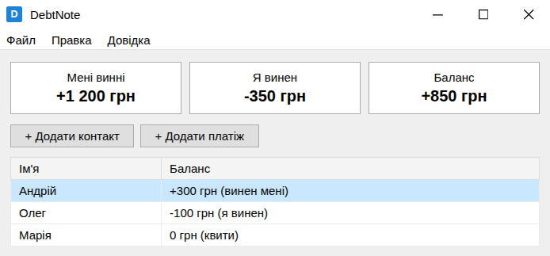
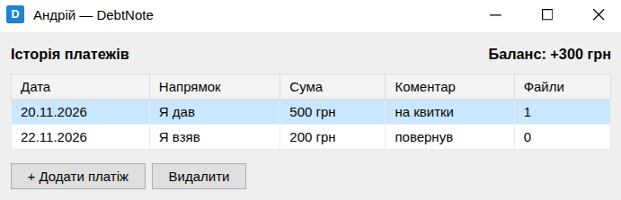
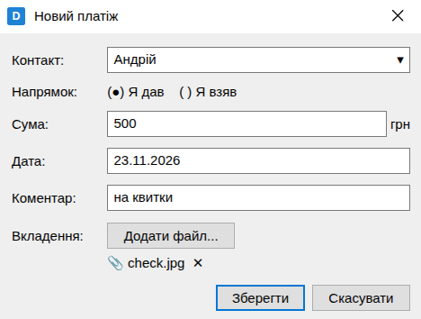
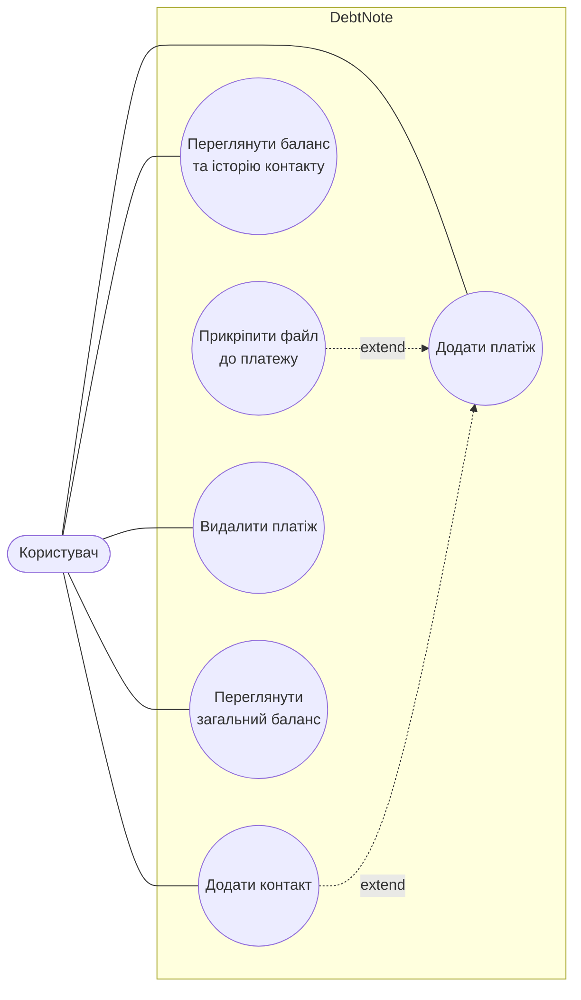

# Етап 2. User Experience та User Stories

## 1. User Stories

| ID   | Історія                                                                                                                                                                            |
| ---- | ---------------------------------------------------------------------------------------------------------------------------------------------------------------------------------- |
| US-1 | Як **користувач**, я хочу **додати борг із вказанням контакту, суми та напрямку** («я дав» / «я взяв»), щоб **не забути, хто кому скільки винен**.                                 |
| US-2 | Як **користувач**, я хочу **бачити список контактів із поточним балансом по кожному і загальний підсумок**, щоб **одразу розуміти свою фінансову картину без ручних підрахунків**. |
| US-3 | Як **користувач**, я хочу **прикріпити до платежу фото чека або скріншот переписки**, щоб **мати підтвердження на випадок суперечки**.                                             |
| US-4 | Як **користувач**, я хочу **записати повернення боргу (повне або часткове)**, щоб **баланс по контакту оновився й показував залишок**.                                             |
| US-5 | Як **користувач**, я хочу **переглянути історію всіх платежів по конкретному контакту**, щоб **згадати, коли і за що виник борг**.                                                 |

## 2. Wireframe

### Головне вікно

### Вікно контакту (історія платежів)

### Діалог додавання платежу

## 3. Варіанти використання (Use Cases)

### UC-1. Додати платіж (борг) із вкладенням

|                |                                                      |
| -------------- | ---------------------------------------------------- |
| **Актор**      | Користувач                                           |
| **Передумова** | Застосунок запущено, у системі є хоча б один контакт |
| **Тригер**     | Користувач натискає «Додати платіж»                  |

**Основний сценарій:**

1. Система відкриває діалог «Новий платіж».
2. Користувач обирає контакт зі списку.
3. Користувач обирає напрямок («я дав» / «я взяв»).
4. Користувач вводить суму, дату та коментар.
5. Користувач за бажанням додає файл-підтвердження (фото чека, скріншот).
6. Користувач натискає «Зберегти».
7. Система перевіряє дані, зберігає платіж і вкладення в базу.
8. Система закриває діалог і оновлює списки та баланси.

**Альтернативні сценарії:**

- 7a. Сума порожня, нульова або від'ємна: система показує повідомлення про помилку, діалог лишається відкритим.
- 5a. Файл недоступний або не є зображенням: система показує помилку, платіж можна зберегти без вкладення.
- 2a. Потрібного контакту немає: користувач переходить до UC-3 (додати контакт) і повертається.

**Постумова:** платіж (і вкладення) збережено, баланс контакту перераховано.

### UC-2. Переглянути баланс та історію по контакту

|                |                                                  |
| -------------- | ------------------------------------------------ |
| **Актор**      | Користувач                                       |
| **Передумова** | У системі є хоча б один контакт                  |
| **Тригер**     | Користувач відкриває застосунок і обирає контакт |

**Основний сценарій:**

1. Система показує головне вікно: список контактів із балансами та загальний підсумок.
2. Користувач натискає по контакту.
3. Система відкриває вікно контакту.
4. Система завантажує всі платежі контакту та обчислює баланс.
5. Система показує таблицю платежів (дата, напрямок, сума, коментар, кількість файлів) і поточний баланс.
6. Користувач обирає платіж і переглядає його вкладення.

**Альтернативні сценарії:**

- 4a. У контакта немає платежів: система показує порожню таблицю та баланс 0.
- 6a. Файл вкладення видалено з диска: система повідомляє, що файл не знайдено.

**Постумова:** дані не змінюються.

### UC-3. Додати контакт

|                |                                      |
| -------------- | ------------------------------------ |
| **Актор**      | Користувач                           |
| **Передумова** | Застосунок запущено                  |
| **Тригер**     | Користувач натискає «Додати контакт» |

**Основний сценарій:**

1. Система відкриває діалог «Новий контакт».
2. Користувач вводить ім'я та за бажанням нотатку.
3. Користувач натискає «Зберегти».
4. Система перевіряє, що ім'я не порожнє.
5. Система зберігає контакт у базу.
6. Система оновлює список контактів на головному вікні.

**Альтернативні сценарії:**

- 4a. Ім'я порожнє: система показує помилку, діалог лишається відкритим.
- 4b. Контакт із таким ім'ям уже існує: система попереджає про дублікат і пропонує підтвердити створення або скасувати.

**Постумова:** новий контакт збережено, його баланс дорівнює 0.

## 4. Діаграма варіантів використання

