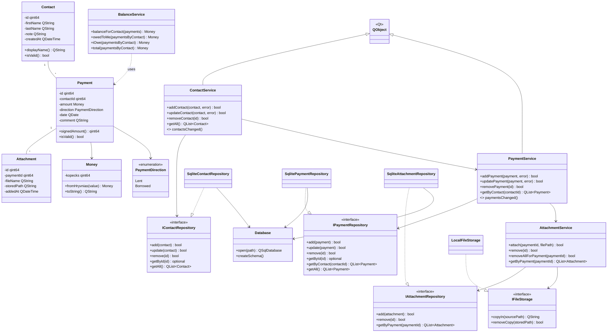
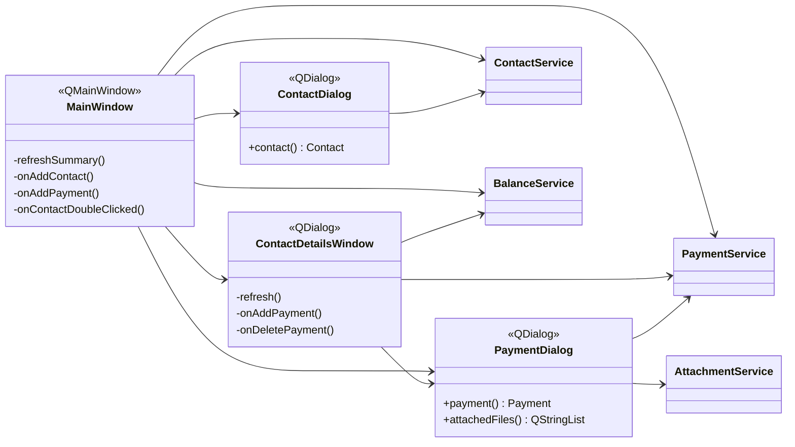

# Етап 4. Архітектура та Design Patterns

## 1. Шари застосунку

```
UI (Qt Widgets)  ->  Services (бізнес-логіка)  ->  Domain (сутності, інтерфейси)  <-  Data (SQLite, файли)
```

| Шар          | Вміст                                                                                                        | Знає про              |
| ------------ | ------------------------------------------------------------------------------------------------------------ | --------------------- |
| **Domain**   | `Contact`, `Payment`, `Attachment`, `Money`, `PaymentDirection`, інтерфейси `I...Repository`, `IFileStorage` | Нікого (лише Qt Core) |
| **Services** | `ContactService`, `PaymentService`, `AttachmentService`, `BalanceService`                                    | Domain                |
| **Data**     | `Database`, `Sqlite...Repository`, `LocalFileStorage`                                                        | Domain                |
| **UI**       | Вікна та діалоги                                                                                             | Services, Domain      |

Domain не залежить ні від кого, а Data і Services залежать від нього. Складання всіх частин відбувається в точці входу програми.

## 2. UML-діаграма: ядро та шар даних



## 3. UML-діаграма: шар інтерфейсу



Шар інтерфейсу залежить лише від сервісів і підписується на їхні сигнали. Конкретний вигляд екранів (списки, картки тощо) може змінюватися без впливу на ядро.

## 4. Використані патерни проєктування

| Патерн                             | Де застосовано                                                                                                  | Навіщо                                                                       |
| ---------------------------------- | --------------------------------------------------------------------------------------------------------------- | ---------------------------------------------------------------------------- |
| **Repository**                     | `I...Repository` та `Sqlite...Repository`                                                                       | Уся робота з SQLite ізольована в одному місці, сервіси не містять SQL        |
| **Dependency Injection**           | Сервіси отримують залежності через конструктор, складання в `main.cpp`                                          | Залежності легко підмінити, наприклад тестовими реалізаціями                 |
| **Observer** (сигнали та слоти Qt) | `ContactService` та `PaymentService` випромінюють `contactsChanged()` / `paymentsChanged()`, вікна підписуються | Інтерфейс оновлюється автоматично після змін даних, сервіси не знають про UI |
| **Service Layer**                  | `ContactService`, `PaymentService`, `AttachmentService`, `BalanceService`                                       | Уся бізнес-логіка зібрана в одному шарі, інтерфейс лише викликає сервіси     |
| **Value Object**                   | `Money`                                                                                                         | Гроші інкапсульовані: сума в копійках без похибок, єдине форматування        |

## 5. Реалізація принципів ООП

- **Інкапсуляція:** поля сутностей приватні, доступ через методи, валідація всередині класів (`isValid()`).
- **Абстракція:** сервіси працюють з інтерфейсами репозиторіїв і файлового сховища.
- **Поліморфізм:** `SqlitePaymentRepository` та будь-яка інша реалізація `IPaymentRepository` взаємозамінні для `PaymentService`.
- **Композиція замість успадкування:** сервіси складаються з залежностей, а успадкування застосоване лише там, де цього вимагає Qt.
