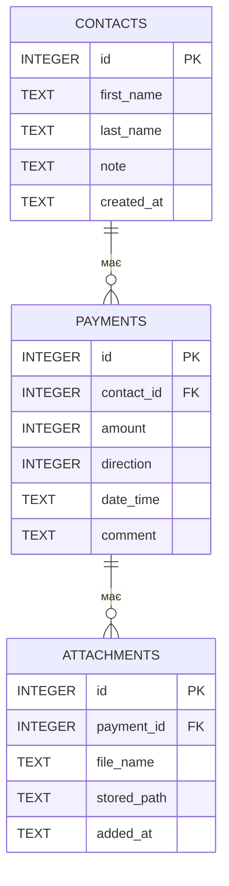

# Етап 5. Data Layer

## 1. Обраний варіант

**Локальна база даних SQLite** через `QSqlDatabase` (драйвер `QSQLITE`). База зберігається одним файлом `debtnote.db` у папці даних застосунку (`QStandardPaths::AppDataLocation`), тому користувачу не потрібні сервер, акаунт чи інтернет.

Файли вкладень зберігаються поза базою, у підпапці `attachments/` поруч із нею. У базі лежить лише шлях до копії.

## 2. Схема бази даних



### SQL-схема

```sql
CREATE TABLE IF NOT EXISTS contacts (
    id          INTEGER PRIMARY KEY AUTOINCREMENT,
    first_name  TEXT NOT NULL CHECK (length(trim(first_name)) > 0),
    last_name   TEXT,
    note        TEXT,
    created_at  TEXT NOT NULL
);

CREATE TABLE IF NOT EXISTS payments (
    id          INTEGER PRIMARY KEY AUTOINCREMENT,
    contact_id  INTEGER NOT NULL
                REFERENCES contacts(id) ON DELETE CASCADE,
    amount      INTEGER NOT NULL CHECK (amount > 0),
    direction   INTEGER NOT NULL CHECK (direction IN (0, 1)),
    date_time   TEXT NOT NULL,
    comment     TEXT
);

CREATE TABLE IF NOT EXISTS attachments (
    id           INTEGER PRIMARY KEY AUTOINCREMENT,
    payment_id   INTEGER NOT NULL
                 REFERENCES payments(id) ON DELETE CASCADE,
    file_name    TEXT NOT NULL,
    stored_path  TEXT NOT NULL,
    added_at     TEXT NOT NULL
);

CREATE INDEX IF NOT EXISTS idx_payments_contact ON payments(contact_id);
CREATE INDEX IF NOT EXISTS idx_attachments_payment ON attachments(payment_id);
```

### Опис таблиць

| Таблиця       | Клас домену  | Примітки                                                                     |
| ------------- | ------------ | ---------------------------------------------------------------------------- |
| `contacts`    | `Contact`    | `last_name` та `note` необов'язкові                                          |
| `payments`    | `Payment`    | `amount` у копійках, завжди більше нуля, знак визначається полем `direction` |
| `attachments` | `Attachment` | `stored_path` це шлях до копії файлу в папці застосунку                      |

### Відповідність типів

| Поле домену                        | Тип у C++          | Тип у SQLite | Формат                                                                                   |
| ---------------------------------- | ------------------ | ------------ | ---------------------------------------------------------------------------------------- |
| `id`                               | `qint64`           | `INTEGER`    | автоінкремент                                                                            |
| `amount` (`Money`)                 | `qint64` (копійки) | `INTEGER`    | ціле число копійок                                                                       |
| `direction`                        | `PaymentDirection` | `INTEGER`    | значення enum: `0` = `Lent` (я дав), `1` = `Borrowed` (я взяв), через `static_cast<int>` |
| `dateTime`, `createdAt`, `addedAt` | `QDateTime`        | `TEXT`       | ISO 8601 (`yyyy-MM-ddTHH:mm:ss`), через `Qt::ISODate`                                    |

## 3. Цілісність даних

- Видалення контакта видаляє його платежі, видалення платежу видаляє записи вкладень.
- Перед видаленням платежу чи контакта `AttachmentService` спочатку видаляє копії файлів із папки застосунку (оригінали користувача не чіпаються), а потім запис видаляється з бази.
- Обмеження `CHECK` дублюють перевірки домену (сума більше нуля, допустимий напрямок, непорожнє ім'я), тож некоректні дані не потраплять у базу навіть при помилці в коді.
- Баланс у базі не зберігається. Він обчислюється `BalanceService` із платежів, тому розсинхронізація неможлива.

## 4. Клас `Database`

Відповідає лише за з'єднання та схему:

| Метод            | Що робить                                                        |
| ---------------- | ---------------------------------------------------------------- |
| `open(path)`     | Відкриває з'єднання `QSQLITE`, вмикає `PRAGMA foreign_keys = ON` |
| `createSchema()` | Створює таблиці та індекси через `CREATE ... IF NOT EXISTS`      |

## 5. Репозиторії

Кожен репозиторій реалізує інтерфейс домену та працює лише зі своєю таблицею.

| Клас                         | Інтерфейс               | Таблиця       |
| ---------------------------- | ----------------------- | ------------- |
| `SqliteContactRepository`    | `IContactRepository`    | `contacts`    |
| `SqlitePaymentRepository`    | `IPaymentRepository`    | `payments`    |
| `SqliteAttachmentRepository` | `IAttachmentRepository` | `attachments` |

Запити виконуються параметризовано (`QSqlQuery::prepare` та `bindValue`), що захищає від SQL-ін'єкцій.

Значення enum `PaymentDirection` задаються явно (`Lent = 0`, `Borrowed = 1`), щоб числа в базі не змінилися при зміні порядку в коді.

## 6. Файлове сховище вкладень

`LocalFileStorage` (реалізація `IFileStorage`) копіює вибраний файл у `attachments/` під унікальною назвою (наприклад, із префіксом у вигляді часу та випадкового ідентифікатора), щоб файли з однаковими назвами не перезаписували один одного. Видаляє він лише такі копії.
